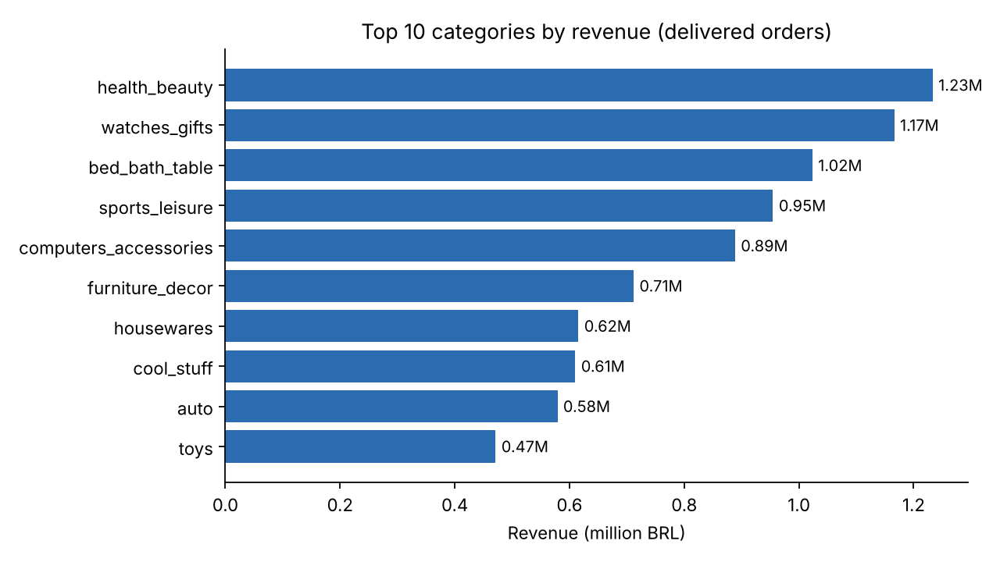
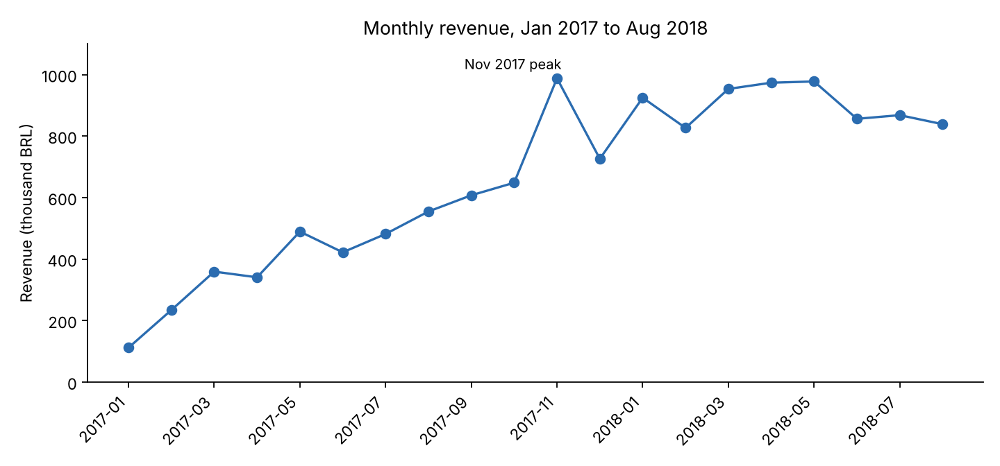
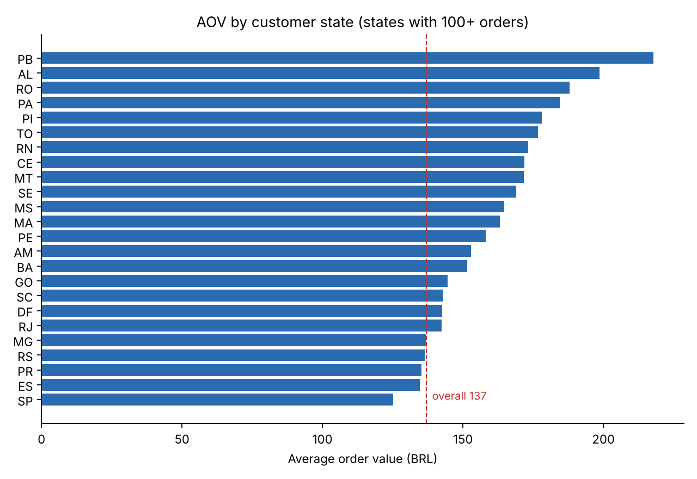

# E-commerce Sales and Category Performance Analysis

An end-to-end SQL and Python analysis of the Olist Brazilian e-commerce dataset (96,478 delivered orders, 13.2M BRL revenue). It answers five business questions: which categories and sellers drive revenue, how revenue changes month to month, how much customers spend per order, and how many customers come back.

**Tools:** SQL (SQLite), Python (pandas, matplotlib)

## Key findings

| Question | Result |
|---|---|
| Delivered orders analysed | 96,478 (of 99,441 total) |
| Total revenue (item price, excl. freight) | 13,221,498 BRL |
| Top category | `health_beauty`, 9.33% of revenue |
| Top 5 / top 10 categories (of 74) | 39.83% / 62.43% of revenue |
| Seller concentration | Top 10% of 2,970 sellers earn 67.11% of revenue |
| Overall average order value (AOV) | 137.04 BRL |
| AOV by state (states with 100+ orders) | Highest `PB` at 217.77 BRL; lowest `SP` at 125.12 BRL |
| Peak revenue month | Nov 2017: 987,765 BRL, up 52.37% on October |
| Repeat customer rate | 3.00% (2,801 of 93,358 customers) |





### What the data shows

- **Revenue is spread across many categories but the top few matter.** The top 5 categories earn about 40% of revenue, led by health and beauty, watches and gifts, and bed, bath and table.
- **Sellers are highly concentrated.** Roughly 300 sellers generate two thirds of revenue, so losing a few top sellers would hurt noticeably.
- **Growth was fast in 2017, then flattened.** Monthly revenue rose from about 112K BRL in Jan 2017 to a 988K BRL peak in Nov 2017. Since Jan 2018 it has stayed between about 826K and 978K BRL.
- **The Nov 2017 spike is consistent with Black Friday**, which fell in that month. The dataset does not label promotions, so this is an inference, not a measured effect.
- **Order values are higher outside São Paulo.** `SP` has the most orders (40,501, about 42% of the total) and the lowest AOV; smaller northern and north-eastern states such as `PB`, `AL` and `RO` average 188 to 218 BRL.
- **Almost nobody comes back.** Only 3.0% of customers ordered more than once.

## Business recommendation

Growth has plateaued since early 2018 while the repeat rate is only 3%, so the biggest lever is retention, not acquisition. Introduce post-purchase offers or reminders for the top categories, and test them first in high-AOV states. Separately, build a seller-retention plan for the top-decile sellers, since they carry two thirds of revenue.

## Business questions

1. Which product categories generate the most revenue, and how concentrated is it?
2. Who are the top sellers within each category?
3. How does revenue change month over month, and is there seasonality?
4. What is the average order value, and how does it vary by state?
5. What share of customers place more than one order?

## Dataset

- **Source:** Olist Brazilian E-Commerce Public Dataset (about 100,000 orders, 2016 to 2018). Available on [Kaggle](https://www.kaggle.com/datasets/olistbr/brazilian-ecommerce) and in the [official Olist GitHub repository](https://github.com/olist/work-at-olist-data). The raw data is not committed here; see licence terms on those pages.
- **Tables used:** `orders`, `order_items`, `products`, `customers`, `product_category_name_translation`.
- **Scope:** only orders with status `delivered`.
- **Revenue definition:** sum of item `price`, excluding freight.
- **Monthly analysis window:** Jan 2017 to Aug 2018. Earlier months have almost no orders and Sep to Oct 2018 are incomplete, which would distort growth rates.
- **Repeat customers** are counted by `customer_unique_id`. In this dataset `customer_id` changes with every order, so using it would show no repeat buyers.

## Approach

1. Loaded the CSV files into SQLite (`sql/load_data.py`).
2. Filtered to delivered orders and checked row counts and the date range.
3. Wrote the queries (joins, CTEs, window functions) in `sql/analysis_queries.sql`.
4. Ran them and generated charts with `analysis.py`.
5. Cross-checked total revenue, order count, AOV and repeat rate independently in pandas. The numbers matched.

## SQL techniques used

- `JOIN` and `LEFT JOIN` across five tables
- `GROUP BY`, `HAVING`, `CASE WHEN`, `COALESCE`
- CTEs (`WITH`)
- Window functions: `RANK() OVER (PARTITION BY ...)`, `LAG()`, `SUM() OVER ()`, `NTILE()`

## How to reproduce

```bash
pip install pandas matplotlib
# 1. Download the dataset (Kaggle or the Olist GitHub repo) and put the CSVs in data/
# 2. Build the database
python sql/load_data.py data olist.db
# 3. Run the analysis (writes results/ and charts/)
python analysis.py olist.db
```

## Project structure

```
.
├── README.md
├── analysis.py               # runs the queries, exports results and charts
├── sql/
│   ├── load_data.py          # CSV to SQLite loader
│   └── analysis_queries.sql  # all analysis queries
├── results/                  # query outputs as CSV, summary.json
├── charts/                   # exported charts
└── data/                     # raw CSVs (not committed)
```

## Limitations and next steps

- No cost data, so profit margin could not be analysed; revenue is the metric.
- Only delivered orders were included; cancelled and unavailable orders were excluded.
- The dataset is a sample from one marketplace, so figures describe this sample.
- Next steps: cohort retention by first-purchase month, delivery time versus review score, and category-level repeat rates.
